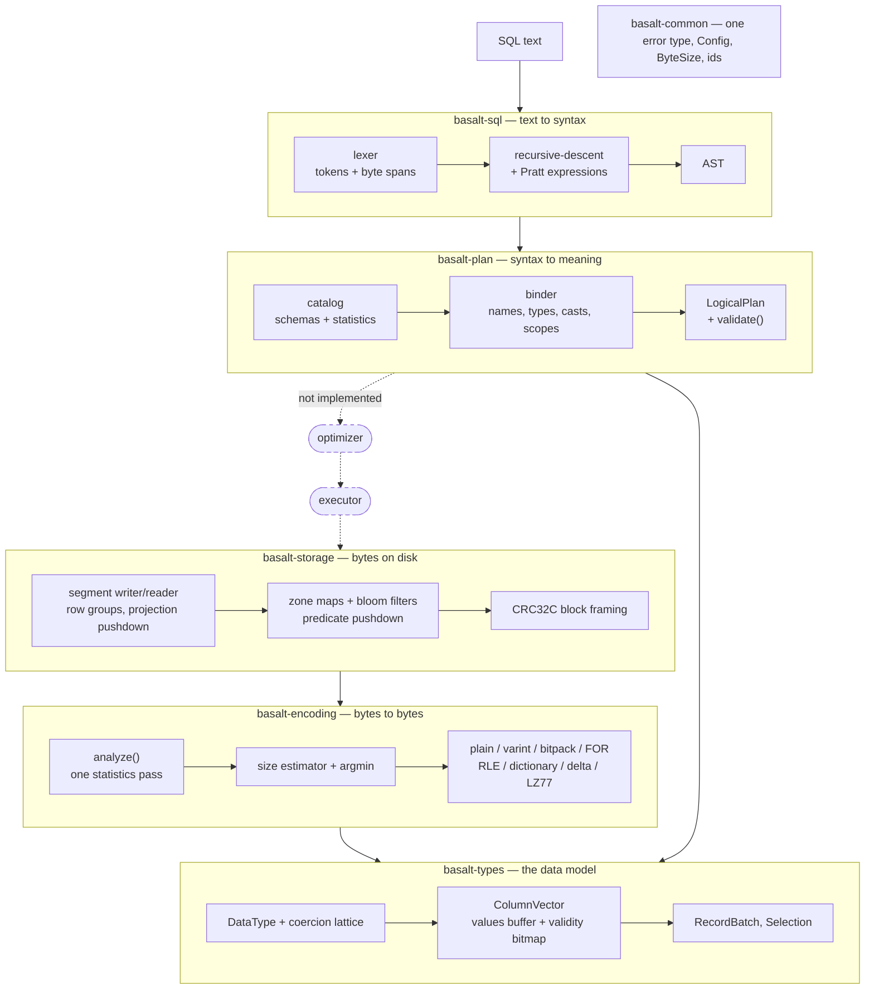

# Basalt

An embedded columnar analytical database engine written in Rust from first principles: its own type
system, columnar arrays, compression codecs, on-disk segment format, SQL parser and query planner,
with no `arrow`, `parquet`, `datafusion` or `sqlparser` anywhere in the dependency graph.

[](https://github.com/basalt-db/basalt/actions/workflows/ci.yml)
[](LICENSE)
[](rust-toolchain.toml)

> **Status: there is no optimizer and no executor.** Basalt reads a segment file and it plans a SQL
> query, but it does not yet run one. See [Status and what is not implemented](#status-and-what-is-not-implemented),
> which is the section worth reading before any of the others.

## What this is, and why it exists

Basalt exists to make the machinery of a columnar engine legible. Every part that a production
engine would take off the shelf — the bitmap null mask, the bit packer, the dictionary encoder, the
CRC'd block framing, the Pratt expression parser, the name resolver — is written out here, with the
reasoning for each choice in the module that implements it. The interesting question is never "does
it work", it is "why is it built this way, and what does the other way cost", and that argument is
the artifact.

It is not a DuckDB competitor and will not become one. DuckDB is a decade of vectorised kernels,
parallel operators and edge cases; Basalt is one workspace of libraries that a person can read end
to end in an afternoon. Where the two disagree, DuckDB is probably right and Basalt is probably
easier to understand.

The one runtime dependency is `thiserror`. The [dependency policy](Cargo.toml) at the top of the
workspace manifest records what was deliberately *not* taken, and why.

## Architecture



## The crates

| Crate | What it is |
|---|---|
| [`basalt-common`](crates/basalt-common) | One error enum for the whole engine (corruption reports carry a region and a byte offset), `Config`, `ByteSize`, monotonic ids. |
| [`basalt-types`](crates/basalt-types) | `DataType` and its documented coercion lattice, `Value` with a genuine total order, `Bitmap`, `Buffer`, the columnar arrays, `RecordBatch`, `Schema`, `Selection`. |
| [`basalt-encoding`](crates/basalt-encoding) | Bit packing, zigzag varints, RLE, dictionary, frame-of-reference, delta, an in-tree LZ77, and the statistics-driven selector that chooses between them. Measured numbers in [`BENCHMARKS.md`](crates/basalt-encoding/BENCHMARKS.md). |
| [`basalt-storage`](crates/basalt-storage) | The immutable segment format: row groups, per-chunk zone maps and bloom filters, CRC32C on every block, projection and predicate pushdown. Byte-level spec in [`FORMAT.md`](crates/basalt-storage/FORMAT.md). |
| [`basalt-sql`](crates/basalt-sql) | Hand-written lexer and recursive-descent parser with a Pratt expression loop, a span-carrying AST, a printer that round-trips, and diagnostics with "did you mean" hints. |
| [`basalt-plan`](crates/basalt-plan) | Catalog with statistics, resolved expressions keyed by column *identity*, the function registry, the binder (scopes, correlation, aggregate rules, explicit casts) and the logical plan with `validate()` and an `EXPLAIN`-style `Display`. |

## What it does today

Parse, resolve and plan a query (this is the crate-level doctest of `basalt-plan`, so it is
compiled and run by `cargo test`; `?` implies an enclosing function returning `Result`):

```rust
use basalt_plan::{bind, Catalog, TableDefinition};
use basalt_types::{DataType, Field, Schema};

let mut catalog = Catalog::new();
catalog.create_table(TableDefinition::new(
    "orders",
    Schema::new(vec![
        Field::new("id", DataType::Int64, false),
        Field::new("total", DataType::Float64, true),
    ])?,
))?;

let statement = basalt_sql::parse("SELECT id FROM orders WHERE total > 10")?;
let plan = bind(&statement, &catalog)?;
println!("{plan}");
```

which prints the plan the way `EXPLAIN` should — note the cast the binder inserted, so that no
stage downstream has to decide how to compare an `INT64` literal with a `FLOAT64` column:

```text
Projection: orders.id
  Filter: (orders.total > CAST(10 AS FLOAT64))
    TableScan: orders projection=[id, total]
```

Write a segment and read part of it back, skipping row groups by their zone maps and reading only
the projected column — the crate docs for [`basalt-storage`](crates/basalt-storage/src/lib.rs)
carry the full, doctested version, including the `CountingSource` that lets you verify the bytes
actually saved.

When something is wrong, the front end says where:

```text
error: expected FROM, WHERE, GROUP BY, HAVING, ORDER BY, LIMIT or end of statement, found identifier `form`
 --> 1:10
  |
1 | SELECT * FORM orders
  |          ^^^^
  = hint: did you mean `FROM`?
```

## Status and what is not implemented

Basalt is six library crates, 476 passing tests and about 32 000 lines of Rust. What follows is the
honest inventory, not a roadmap.

### The big one: no optimizer, no executor

There is no `basalt-optimizer` and no `basalt-exec`. A statement is tokenized, parsed, bound against
a catalog and turned into a validated `LogicalPlan` — and then it stops. **No query returns rows.**
`INSERT` binds and casts its source but never writes; `CREATE TABLE` produces a `BoundStatement` and
never touches the catalog; `EXPLAIN` builds the node but nothing renders it as a result set.
Everything in `basalt-storage` works and is tested independently, but no plan is connected to it.

Some things that would live in an optimizer already happen at bind time, because they make the
unoptimized plan more useful: join conditions are split into equi-keys and a residual predicate,
`BETWEEN` is desugared into two range predicates, and a constant `IN` list of eight or more elements
becomes a hash set.

### SQL the binder parses and then refuses

Each of these is a `BasaltError::Unsupported` — never a silently different plan. The list is
enforced by `crates/basalt-plan/tests/reject.rs::parsed_but_not_planned`:

| Construct | Message |
|---|---|
| Scalar subquery, `SELECT (SELECT 1)` | "scalar subqueries are parsed but not yet planned; rewrite as a join" |
| `EXCEPT` | "Except is parsed but not yet planned; only UNION is implemented" |
| `INTERSECT` | "Intersect is parsed but not yet planned; only UNION is implemented" |
| `WITH RECURSIVE` | "WITH RECURSIVE is parsed but not yet planned" |
| Parameters, `$1` and `?` | "query parameters are parsed but not yet bound; inline the value" |
| `CREATE VIEW` / `DROP VIEW` | "views are parsed but not yet planned" |
| `EXPLAIN` of anything but a query | "EXPLAIN of CREATE TABLE is not supported; only queries can be explained" |
| Three-part names, `s.t.a` | "qualified name s.t.a has 2 qualifiers; only relation.column is supported" |

`EXCEPT` and `INTERSECT` are anti- and semi-joins on every column with null-safe equality. They are
refused rather than approximated, because an approximation that gets `NULL` handling wrong is worse
than a clear refusal.

### Known limitations that are bugs or rough edges, not decisions

* **`ORDER BY` sees only the query's output.** `SELECT id FROM orders ORDER BY total` is rejected
  with "no column named total". Aliases and ordinals work, and so does any column that is projected.
* **`USING` and `NATURAL` keep the left copy of a merged column** rather than the standard's
  `COALESCE(left, right)`. Under a `RIGHT JOIN` the merged column is therefore nullable where the
  standard would say it is not.
* **`LIMIT` and `OFFSET` take a literal**, evaluated at bind time. `LIMIT 1 + 1` and `LIMIT -1` are
  both rejected as "requires a constant, found an expression"; constant folding would fix this and
  belongs in the optimizer that does not exist.
* **`FileSource` is `Send` but not `Sync`.** It holds a `RefCell<File>` and seeks before reading, so
  a segment reader belongs to one thread. A parallel scan wants positioned reads
  (`pread`/`seek_read`) instead; the trait `SegmentSource` is already shaped for it.
* **The catalog is in memory and is never written to.** There is no persistence of schemas, and
  `TableStatistics` are only ever what a caller sets.

### Type-system choices you may disagree with

These are decisions, documented where they are implemented, and each is covered by tests:

* **`DECIMAL` never implicitly becomes a `FLOAT`.** `coerce(Decimal128(p, s), Float64)` is `None`,
  so `WHERE float_col > 10.5` is a *type error*: a fractional literal is a `DECIMAL`, and promoting
  either side would destroy the exactness that made someone choose `DECIMAL`. Write the cast.
  ([ADR 0008](docs/adr/0008-refuse-decimal-to-float-coercion.md))
* **`INT64 / INT64` is `FLOAT64`.** Truncating integer division silently corrupts averages, so
  Basalt does not offer it implicitly. `%` keeps the integer type, where truncation is the point.
* **`UINT64` has no common type with any signed integer.** `Int64` cannot hold `u64::MAX` and
  `Float64` would round it, so the lattice returns `None` instead of guessing.
* **`Int64 -> Float64` is allowed and is the only lossy promotion in the lattice.** Refusing it
  would break `avg(bigint_column)`; `is_lossless_coercion` reports it so a planner can warn.
* **Booleans do not meet numbers.** `WHERE flag = 1` against a `BOOLEAN` column is a type error.

## Measured numbers

From [`crates/basalt-encoding/BENCHMARKS.md`](crates/basalt-encoding/BENCHMARKS.md), produced by
`cargo bench -p basalt-encoding` on aarch64 with rustc 1.83, over 65 536 `i64` values (512 KiB
plain) per column. **The selector picked the smallest candidate in all seven shapes.**

| Column shape | Encoding chosen | Size | Ratio |
|---|---|--:|--:|
| `sorted_ids` — monotonic key | DELTA | 1 034 B | 507x |
| `long_runs` — 512-row runs | RLE | 455 B | 1152x |
| `low_cardinality` — 8-value enum | DICTIONARY | 24 593 B | 21.3x |
| `small_values` — signed, `-32..32` | BITPACKED | 49 158 B | 10.7x |
| `skewed` — small values, rare 64-bit outlier | DICTIONARY | 74 529 B | 7.0x |
| `clustered_timestamps` — 1 s window, µs | FOR | 163 854 B | 3.2x |
| `high_entropy` — splitmix64 output | PLAIN | 524 293 B | 1.0x |

Throughput, encode / decode:

| Shape | Codec | Encode | Decode |
|---|---|--:|--:|
| `long_runs` | RLE | 34.0 µs (14.4 GiB/s) | **6.53 µs (74.8 GiB/s)** |
| `sorted_ids` | DELTA | 30.5 µs (16.0 GiB/s) | 44.2 µs (11.1 GiB/s) |
| any | PLAIN baseline | ~22.6 µs (21.6 GiB/s) | ~61 µs (8.0 GiB/s) |

Two lines are worth internalising. RLE decodes **9x faster than plain** while being 1152x smaller —
compression is free in both currencies when a column has runs. And on `high_entropy` every clever
encoding is *larger* than plain (varint by 19 %, RLE by 31 %), which is why the selector estimates
sizes instead of pattern-matching on shape.

The write path's bottleneck is the statistics pass, not the codecs: `analyze` runs at ~750 MiB/s and
costs about 29x a plain encode, dominated by the exact distinct-value set. That trade is deliberate
and the alternative is discussed in `BENCHMARKS.md`.

String columns reach 13.3x (`city_enum`), 4.4x (all-distinct ids) and 23.9x (templated URLs); the
in-tree LZ77 gets 6.9x on JSON and expands incompressible input by 0.4 %, which is why
`encode_bytes_adaptive` measures rather than guesses.

## How to read this codebase

Five files, in this order. Each one is written to be read top to bottom, and the module
documentation carries the argument rather than the commit history.

1. **[`crates/basalt-types/src/datatype.rs`](crates/basalt-types/src/datatype.rs)** — the type
   system and the twelve-rule coercion lattice. Everything else is downstream of these rules, and
   the rules are stated as prose you can disagree with.
2. **[`crates/basalt-types/src/array.rs`](crates/basalt-types/src/array.rs)** — the columnar
   representation: dense value buffers, an optional validity bitmap, offsets plus one data buffer
   for variable-length types, O(1) slicing.
3. **[`crates/basalt-encoding/src/stats.rs`](crates/basalt-encoding/src/stats.rs)** — the encoding
   selector. One statistics pass, a closed-form size estimate per candidate, an argmin, and a margin
   that `Plain` has to lose by. This is the file that decides what the engine's compression is worth.
4. **[`crates/basalt-storage/src/reader.rs`](crates/basalt-storage/src/reader.rs)** (with
   [`FORMAT.md`](crates/basalt-storage/FORMAT.md) open beside it) — how a scan turns a predicate
   into a decision not to read bytes, and how corruption is detected rather than returned.
5. **[`crates/basalt-plan/src/binder.rs`](crates/basalt-plan/src/binder.rs)** — the largest single
   file, and the one where SQL stops being text: scopes, correlated references, aggregate placement
   rules, and every implicit conversion made explicit.

Then [`ARCHITECTURE.md`](ARCHITECTURE.md) for how the pieces fit together, and
[`docs/adr/`](docs/adr) for the eight decisions that shaped them.

## Building

Requires the pinned toolchain in [`rust-toolchain.toml`](rust-toolchain.toml) (Rust 1.83).

```sh
make            # help
make build      # cargo build --workspace --all-targets
make test       # cargo test --workspace
make fmt        # cargo fmt --all
make lint       # cargo clippy --workspace --all-targets -- -D warnings
make doc        # cargo doc --no-deps --workspace, warnings denied
make bench      # cargo bench -p basalt-encoding
make ci         # everything CI runs, in the same order
```

## Contributing, license, security

* [`CONTRIBUTING.md`](CONTRIBUTING.md) — what a change is expected to come with.
* [`CODE_OF_CONDUCT.md`](CODE_OF_CONDUCT.md) — Contributor Covenant 2.1.
* [`SECURITY.md`](SECURITY.md) — how to report a vulnerability, and the threat model.
* [`CHANGELOG.md`](CHANGELOG.md) — Keep a Changelog format.

Licensed under the [Apache License, Version 2.0](LICENSE).
